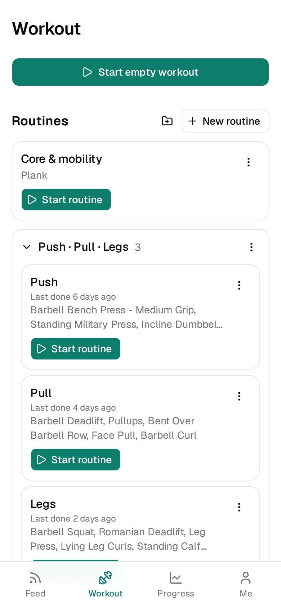
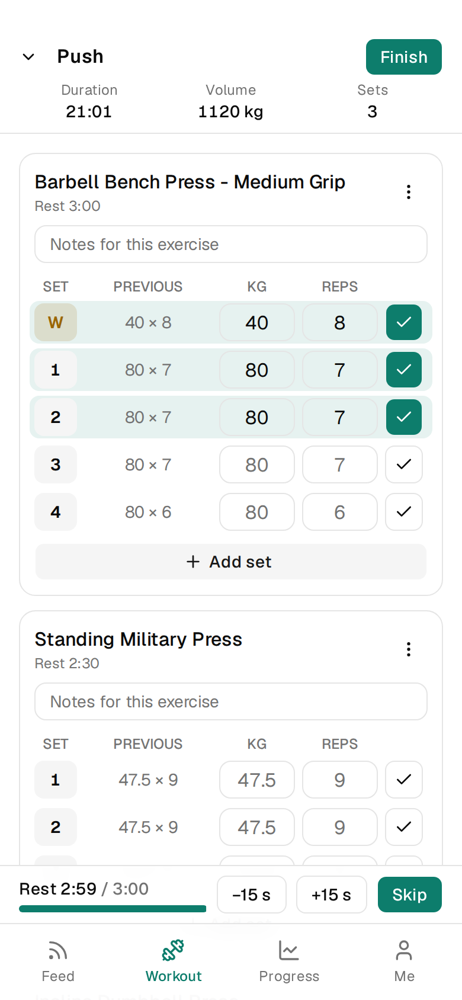
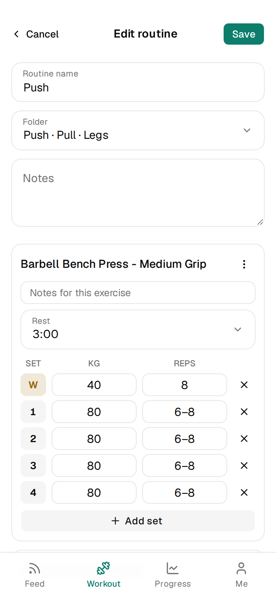
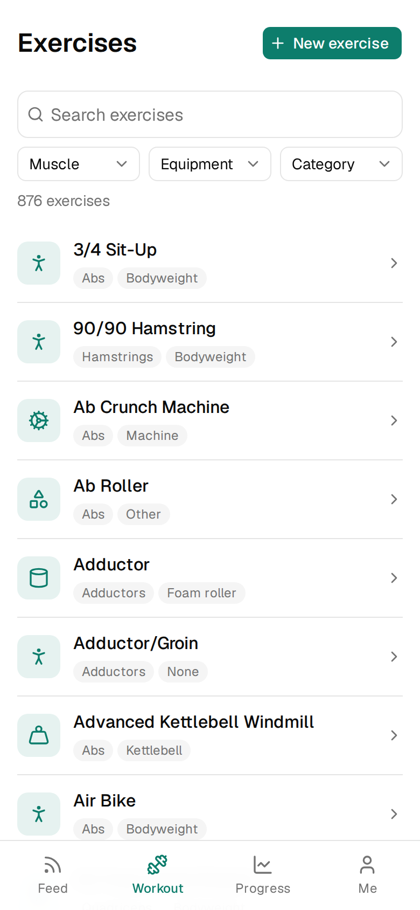

<p align="center"></p>

<h1 align="center">kipitfit</h1>

<p align="center">
  <b>Self-hosted workout tracker.</b><br>
  Plan routines, log every set at the gym, see your records and progress, and follow your friends' training.
</p>

<p align="center">
  <a href="#quick-start">Quick start</a> ·
  <a href="docs/design.md">Design</a>
</p>

One Go binary with SQLite and the React app embedded, installed on the phone as a PWA, in the spirit of Hevy.
Invite-only, English and French, kg and lb.

**Status: skeleton.** Accounts work (first admin, sign-in, invites, profile). Exercises, routines, workouts,
records, friends and import come next; see [docs/design.md](docs/design.md) for the plan.

## Screenshots

<table>
  <tr>
    <td width="25%"><picture>
  <source media="(prefers-color-scheme: dark)" srcset="docs/screenshots/routines-dark.png">
  
</picture></td>
    <td width="25%"><picture>
  <source media="(prefers-color-scheme: dark)" srcset="docs/screenshots/live-dark.png">
  
</picture></td>
    <td width="25%"><picture>
  <source media="(prefers-color-scheme: dark)" srcset="docs/screenshots/routine-dark.png">
  
</picture></td>
    <td width="25%"><picture>
  <source media="(prefers-color-scheme: dark)" srcset="docs/screenshots/exercises-dark.png">
  
</picture></td>
  </tr>
  <tr>
    <td align="center"><sub>Routines, in folders</sub></td>
    <td align="center"><sub>Log sets against last time, with a rest timer</sub></td>
    <td align="center"><sub>Plan sets, reps and rest</sub></td>
    <td align="center"><sub>Over 850 exercises, or your own</sub></td>
  </tr>
</table>

## Quick start

```sh
docker compose up --build
docker compose logs kipitfit | grep setup_token
```

Open http://localhost:8080, paste the setup token and create the admin account. Invite people from **Me → Invites**:
each invite is a link that works once, for 7 days.

For development, run `make dev-api` and `make dev-web` side by side, then open http://localhost:5173 (Vite proxies
`/api` to the Go server on :8080). The setup token is in the `make dev-api` output.

## Configuration

Environment variables, all optional:

| Variable | Default | What |
|---|---|---|
| `KIPITFIT_ADDR` | `:8080` | Listen address for the app and API. |
| `KIPITFIT_DATA_DIR` | `/data` | Holds `kipitfit.db`. Local disk only, never NFS/SMB. |
| `KIPITFIT_LOG_LEVEL` | `info` | `debug`, `info`, `warn` or `error`. |
| `KIPITFIT_APP_URL` | `http://localhost:<port>` | Public URL, used in invite links. |
| `KIPITFIT_COOKIE_SECURE` | `false` | `true` behind HTTPS: Secure session cookie and HSTS. |
| `KIPITFIT_SETUP_TOKEN` | random | Token required to create the first admin, instead of the one printed in the logs. |
| `KIPITFIT_REAL_IP_HEADER` | none | Header a reverse proxy puts the client IP in (`CF-Connecting-IP`, `X-Forwarded-For`). Needs `KIPITFIT_TRUSTED_PROXIES`. |
| `KIPITFIT_TRUSTED_PROXIES` | none | Comma-separated CIDRs or IPs allowed to set that header, e.g. the cluster's pod network. |
| `KIPITFIT_S3_ENDPOINT` | none | S3-compatible endpoint for exercise pictures, e.g. `http://rustfs:9000`. Without it, media is off: equipment icons. |
| `KIPITFIT_S3_BUCKET` | `kipitfit` | Bucket, created beforehand. Keep it private: the app streams from it. |
| `KIPITFIT_S3_ACCESS_KEY_ID`, `KIPITFIT_S3_SECRET_ACCESS_KEY` | none | Credentials with read and write on the bucket. |
| `KIPITFIT_S3_REGION` | `us-east-1` | RustFS and MinIO take any; R2 wants `auto`. |

## Exercise pictures

kipitfit ships no exercise pictures: the good ones are licensed and can't be republished. Each deployment imports its
own **pack**, which uploads the pictures to your bucket and becomes the exercise library:

```sh
kipitfit pack import repdb-free                      # RepDB's free tier, downloaded from repdb.co
kipitfit pack import --sha256 <hex> repdb-free ./repdb-free.zip   # or a copy you keep
```

In a container, run it in the app's own: `docker compose exec kipitfit /kipitfit pack import repdb-free` (or
`kubectl exec deploy/kipitfit -- /kipitfit pack import repdb-free`). It prints the ZIP's SHA-256; running it again
skips the pictures already uploaded. Routines and workouts keep their history: each moves to the pack exercise with the
same name and kind, the old library is archived. Respect the pack's licence: RepDB's free tier asks for the credit
"Exercise data by RepDB (repdb.co)", which kipitfit shows on **Me → About**.

## API

JSON over HTTP with a session cookie (`kipitfit_session`, 30 days). Mutations from another origin are refused.
Errors answer `{"error": "...", "code": "...", "params": {...}}`; the app shows `errors.<code>` from its catalogs.

| Method | Path | Auth | Does |
|---|---|---|---|
| GET | `/api/health` | none | 204 when up. |
| GET | `/api/auth/state` | none | `{setupRequired, user?}`. |
| POST | `/api/auth/setup` | setup token | `{setupToken, email, name, password}`: creates the first admin and signs in. |
| POST | `/api/auth/login` | none | `{email, password}`: signs in. 10 failures per IP per 15 minutes, then 429. |
| POST | `/api/auth/logout` | none | Ends the session. |
| POST | `/api/invites/accept` | invite token | `{token, name, password}`: creates the invited account and signs in. |
| GET | `/api/me` | session | The signed-in user. |
| PATCH | `/api/me` | session | `{name?, language?, unit?}`: language `""`, `en` or `fr`; unit `kg` or `lb`. |
| GET | `/api/admin/invites` | admin | Pending invites, newest first. |
| POST | `/api/admin/invites` | admin | `{email}`: returns the invite with its `link`, shown only once. |
| DELETE | `/api/admin/invites/{id}` | admin | Revokes an invite. |
| GET | `/api/exercises` | session | The library and your own exercises, by name, without instructions. Search and filters run in the app. |
| GET | `/api/exercises/{id}` | session | One exercise with its instructions. Another user's exercise is a 404. |
| POST | `/api/exercises` | session | `{name, kind, category?, equipment?, primaryMuscles, secondaryMuscles?}`: creates your own exercise. |
| PATCH | `/api/exercises/{id}` | session | Same fields, all optional. Library exercises answer 403 `library_exercise_readonly`. |
| DELETE | `/api/exercises/{id}` | session | Deletes your own exercise; one a routine or workout uses is archived instead: hidden from the list, still in routines, its GET says `archived: true`. |
| GET | `/api/exercises/{id}/progress` | session | `{records, repRecords, sessions}`: your current best of each record kind, the heaviest weight for 1–12 reps, and every workout with it, newest first (`sets`, `best` per record kind, the `records` it beat). Archived exercises too. |
| GET | `/api/routines` | session | `{folders, routines}` in order; each routine has its `exercises` (with the `exercise` itself, archived too), target `sets` and `lastDoneAt`. |
| POST | `/api/routines` | session | `{name, notes?, folderId?, exercises: [{exerciseId, superset?, restS?, notes?, sets: [{type, weightG?, repsMin?, repsMax?, durationS?, distanceM?}]}]}`: added after your others. At most 50 exercises and 50 sets each. |
| PUT | `/api/routines/{id}` | session | Same body: replaces the whole routine. Another user's routine is a 404. |
| DELETE | `/api/routines/{id}` | session | Deletes a routine. |
| PUT | `/api/routines/order` | session | `{folders?: [id], routines?: [id]}`: each listed folder or routine takes its index as position. |
| GET | `/api/folders` | session | Your folders, in order. |
| POST | `/api/folders` | session | `{name}`: added after your others. |
| PATCH | `/api/folders/{id}` | session | `{name}`: renames. |
| DELETE | `/api/folders/{id}` | session | Deletes a folder; its routines stay, in no folder. |
| PUT | `/api/workouts/{id}` | session | `{title, notes?, routineId?, startedAt, endedAt, exercises: [{exerciseId, superset?, notes?, sets: [{type, weightG?, reps?, rpe?, durationS?, distanceM?}]}]}` under the ULID the phone made at start: creates the workout, or replaces it, so a retried finish saves once. Values follow the exercise kind; `rpe` 6–10 by 0.5. Returns it with `volumeG` (weight × reps of the non-warm-up sets) and the `records` it beat (`{exerciseId, kind, value, previous, exercise, set, …}`; `set` −1 for a workout total). Another user's id is a 404. |
| GET | `/api/workouts?after=` | session | `{workouts, next?}`: 20 workouts with their exercises, sets and `records`, newest first; pass `next` as `after` for the next page. |
| GET | `/api/workouts/{id}` | session | One workout with its exercises, sets and `records`. |
| DELETE | `/api/workouts/{id}` | session | Deletes a workout; records are worked out from what's left. |
| GET | `/api/previous?exercise=a,b,c` | session | `{exerciseId: sets}`: each exercise's sets in your latest workout that has it (at most 50 exercises). |
| GET | `/api/bests?exercise=a,b,c` | session | `{exerciseId: {kind: value}}`: your current bests, for spotting records while logging (at most 50 exercises; never-done ones left out). |
| GET | `/api/stats?from=<RFC 3339>` | session | each workout since `from` (≤ 400 days back), oldest first: `{id, startedAt, endedAt, volumeG, sets, muscles: {muscle: working sets}}` |
| GET | `/api/library` | session | `{pack, media}`: the imported pack (`name`, `version`, `credit`, `creditUrl`), `null` for the built-in library; whether a media bucket is set. |
| GET | `/api/media/{key}` | session | A pack picture from the bucket (`media` keys of an exercise), cached for a year. |

Passwords: 10 characters minimum, 72 bytes maximum (bcrypt).

## Development

`make test`, `make lint`, `make build` (binary in `bin/`), `make docker`. `make cover` runs every Go test with the race
detector and fails under `COVERAGE_FLOOR`; CI runs it. The end-to-end journeys in `cmd/kipitfit/*_test.go` drive the
real wiring over HTTP on a fresh SQLite database (media in memory), and `routes_test.go` lists who may call each route. `make e2e` builds the app and runs the UI tests (`web/e2e`) with
Playwright in its Docker image: WebKit at iPhone size and desktop Chromium, on the real binary and a fresh database. Rules for contributors (and Claude) are in
[CLAUDE.md](CLAUDE.md).

## License

MIT. The built-in exercise library comes from [free-exercise-db](https://github.com/yuhonas/free-exercise-db) by
yuhonas (Unlicense); see [internal/exercisedb/NOTICE.md](internal/exercisedb/NOTICE.md). Imported packs keep their own
licences.
